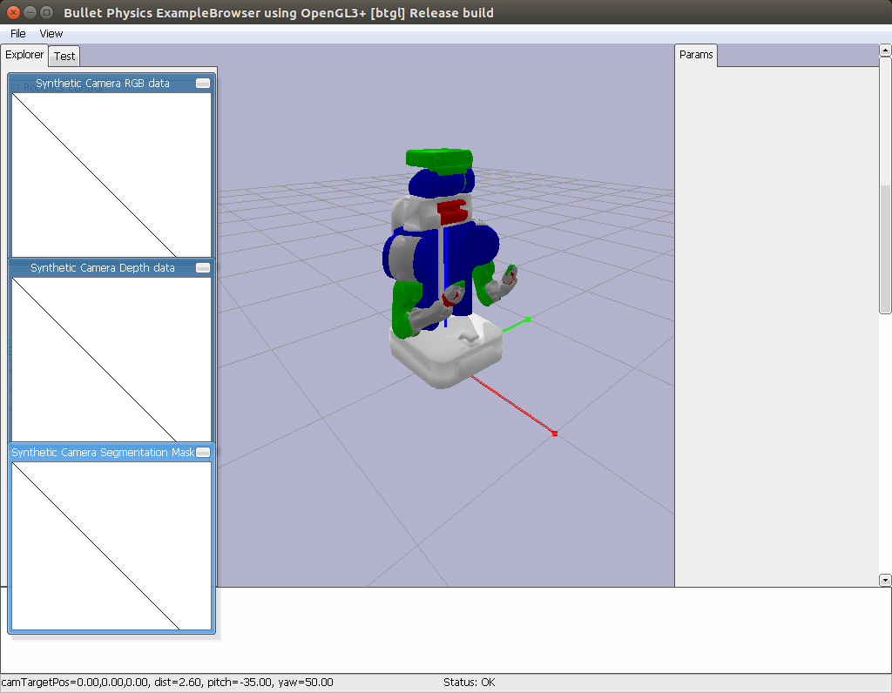

Interfaces
==========

Pybullet Interface
------------------

You can use a Pybullet interface using skrobot.

.. module:: skrobot.interfaces._pybullet

.. autosummary::
   :toctree: generated/
   :nosignatures:

   PybulletRobotInterface

>>> from skrobot.models import PR2
>>> from skrobot.interfaces import PybulletRobotInterface
>>> import pybullet
>>> client_id = pybullet.connect(pybullet.GUI)
>>> robot_model = PR2()
>>> interface = PybulletRobotInterface(robot_model, connect=client_id)
>>> interface.angle_vector(robot_model.reset_pose())

MuJoCo Interface
----------------

Simulate the robot in MuJoCo behind the same calls as the ROS interface.
See :doc:`../examples_guide/mujoco_robot_interface`; it also runs in the
browser, in `scikit-robot-web <https://github.com/iory/scikit-robot-web>`_.

.. module:: skrobot.interfaces._mujoco

.. autosummary::
   :toctree: generated/
   :nosignatures:

   MujocoRobotInterface

>>> import skrobot
>>> from skrobot.interfaces import MujocoRobotInterface
>>> robot = skrobot.models.Jedy()
>>> robot.reset_pose()
>>> ri = MujocoRobotInterface(robot, planar_base=True)
>>> ri.angle_vector(robot.angle_vector(), 2.0)
>>> ri.wait_interpolation()
>>> ri.go_pos(0.3, 0.0, 0.0)
