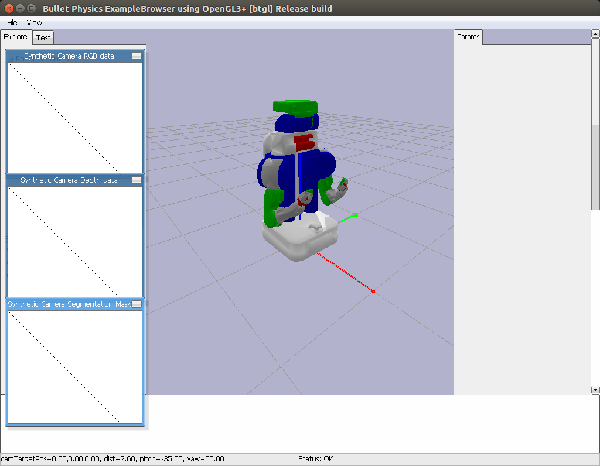

Interfaces
==========

Writing an Interface for Your Robot
-----------------------------------

``RobotInterfaceBase`` gives any robot the ``ri.angle_vector(av, time)`` /
``ri.wait_interpolation()`` / ``ri.potentio_vector()`` call shape without ROS.
It handles controller groups, goals given as a vector or as a
``{joint_name: angle}`` dict, durations from the joint velocity limits
(``time=None`` and ``time_scale``), via-point velocities of
``angle_vector_sequence``, and the measured state. A backend implements four
hooks: ``_send_trajectory``, ``_read_joint_state``, ``_is_interpolating`` and
``_cancel`` (plus ``_set_servo`` if it can switch torque, and
``_wait_interpolation`` if it runs on its own clock).

Measured angles are kept by joint name and never pass through the robot
model, which clamps into the URDF limits: ``measured_angle_vector()`` (and,
in the base class, ``potentio_vector()``) reports an angle past a limit as it
is, and ``outside_limits()`` lists such joints. ``ROS2RobotInterfaceBase`` is
a ``RobotInterfaceBase`` too; for compatibility its ``potentio_vector()``
still returns the clamped model angles, so use ``measured_angle_vector()``
there for the values as published on ``joint_states``.
``FakeRobotInterface`` is an in-memory backend for tests and examples.

.. module:: skrobot.interfaces.base

.. autosummary::
   :toctree: generated/
   :nosignatures:

   RobotInterfaceBase
   hermite_trajectory

.. module:: skrobot.interfaces.fake

.. autosummary::
   :toctree: generated/
   :nosignatures:

   FakeRobotInterface

.. code-block:: python

    from skrobot.interfaces.base import RobotInterfaceBase

    class MyArmInterface(RobotInterfaceBase):

        def __init__(self, robot, device):
            self.dev = device
            super(MyArmInterface, self).__init__(robot)

        def _send_trajectory(self, controller_type, joint_names,
                             positions, velocities, times, start_time):
            self.dev.play(joint_names, positions, times, delay=start_time)

        def _read_joint_state(self):
            return dict(zip(self.dev.joint_names(), self.dev.positions()))

        def _is_interpolating(self, controller_type):
            return self.dev.busy()

        def _cancel(self, controller_type):
            self.dev.stop()

    ri = MyArmInterface(robot, device)
    ri.angle_vector({'elbow_joint': 0.5}, 2.0)
    ri.wait_interpolation()
    print(ri.outside_limits())

Pybullet Interface
------------------

You can use a Pybullet interface using skrobot.

.. module:: skrobot.interfaces._pybullet

.. autosummary::
   :toctree: generated/
   :nosignatures:

   PybulletRobotInterface

>>> from skrobot.models import PR2
>>> from skrobot.interfaces import PybulletRobotInterface
>>> import pybullet
>>> client_id = pybullet.connect(pybullet.GUI)
>>> robot_model = PR2()
>>> interface = PybulletRobotInterface(robot_model, connect=client_id)
>>> interface.angle_vector(robot_model.reset_pose())

``PybulletRobotInterface`` is a ``RobotInterfaceBase``. The calls above keep
setting the motor targets at once; a ``time``, a ``{joint_name: angle}`` goal
or another timed-motion argument sends a trajectory that ``step()`` and
``wait_interpolation()`` carry out in simulation time:

>>> interface.angle_vector({'r_shoulder_pan_joint': 0.5}, 2.0)
>>> interface.wait_interpolation()
>>> interface.measured_angle_vector()

MuJoCo Interface
----------------

Simulate the robot in MuJoCo behind the same calls as the ROS interface.
See :doc:`../examples_guide/mujoco_robot_interface`; it also runs in the
browser, in `scikit-robot-web <https://github.com/iory/scikit-robot-web>`_.

.. module:: skrobot.interfaces._mujoco

.. autosummary::
   :toctree: generated/
   :nosignatures:

   MujocoRobotInterface

>>> import skrobot
>>> from skrobot.interfaces import MujocoRobotInterface
>>> robot = skrobot.models.Jedy()
>>> robot.reset_pose()
>>> ri = MujocoRobotInterface(robot, planar_base=True)
>>> ri.angle_vector(robot.angle_vector(), 2.0)
>>> ri.wait_interpolation()
>>> ri.go_pos(0.3, 0.0, 0.0)
